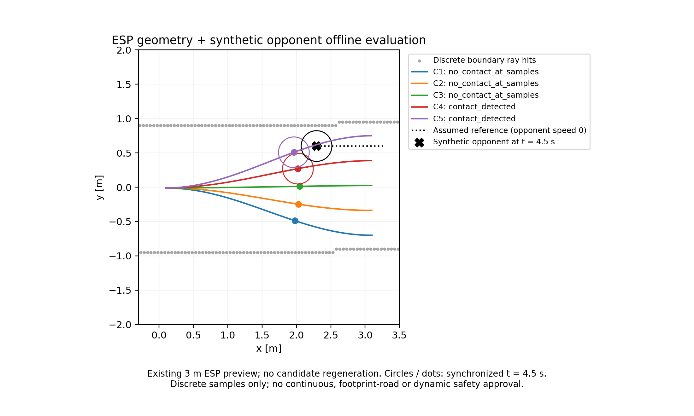

# ESP Offline Evaluation V1 — 保存的 ESP 候選與人工對手

本目錄為離線研究證據，不是真實雙車模擬。`inspection_only=true`、`planning_allowed=false`。



## 版本與研究方法

- Repository：tim8026796-coder/f1tenth_benchmarks，分支 prediction-collision-integration-v1。
- 本次提交父基底：6cab9285b96292a0366f5472bd77b3ed98de891c。
- 歷史 session 記錄的程式 commit：321c9a623a7b4fa5a13723ea6614a1808ffac98f；它與工具提交版本分開記錄。
- 歷史規劃基底：組員 master 4ad0819c0504bf818dd5200a1367f56b600b7454。
- 本次查核時組員 master 已更新為 2374817f2afeafc7416a4b80c7af571a54e5a9ea，新增毫米級規劃、query/generation 模式、車輛參數與 reference-path 語義。**本分支沒有合併這批變更，也不宣稱已驗證所有新模式。**
- 差異核對顯示保存資料所用 PlaybackSession、TrackData、ESP 發布幾何與核心 Geometry 檔案未變；本次僅重現明確綁定舊版本的保存資料。
- 只讀取候選，不呼叫 V5.2、不啟動新 session、不改來源、不計算成本或選路。

流程：保存 session → 按 plan_id、source_control_step、source_sim_time_s、source_pose 精確 join state → 由明確人工路徑產生對手 Prediction → Adapter/Collision → 五候選結果。

不使用 available_sim_time_s 或 points.t 取代來源時間；速度取 state.speed_mps。每個輸出保留原生拒絕、完整度、距離、接觸網格時間與未知區間。

## 檔案清單

| 路徑 | 用途 |
|---|---|
| [all_cases.csv](all_cases.csv) | 25 筆候選；每格採 JSON encoding，null 不當零 |
| [esp_offline_B.png](esp_offline_B.png) | 既有 B 案圖片，220 dpi，圓與點為同步 t=4.5 s；與歷史 PNG 逐位元一致 |
| scenarios/*.json | A～E 的完整人工對手參數 |
| results/*/summary.json | 來源 hash、情境、時間設定、共用批次資訊及五個完整標準摘要 |
| results/*/summary.csv、summary.md | 易讀摘要 |
| sources/esp_short_preview/ | A～D 的原始 metadata、states、plans、summary，共四個必要檔案 |
| sources/esp_timeout_mutated_test/ | E 的歷史測試 archive，僅供 terminal plan 1 拒絕驗證，見警告 |
| sources/*_origin.json | 原始暫存位置、分類、四個來源檔 SHA256 |
| [manifest.json](manifest.json) | 相對路徑、檔案大小與 SHA256（不含本 README 與 manifest 自身） |

未提交整個 pytest 目錄、index／progress／actions 等非重現必要記錄、快取、虛擬環境或測試 log。原始四個檔案未裁切／改寫，以保留原 plan ID／state 控制步與 summary 數量。

本資料為本專案流程產生的研究記錄，保留來源、版本及 SHA256；repository 既有 [LICENSE.md](../../../LICENSE.md) 為 Apache-2.0。本次未另附第三方 PDF 或地圖影像，也不將原來源權利重新標為獨立創作。

## 來源分類與限制

### A～D 主來源

真正由官方 runner.run_session、ESP 地圖與 V5.2 產生的**已保存單元測試短預覽**；不是手工 stub 候選，也不是正式整圈／雙車運行。

原測試：tests/research/test_overtaking_session.py::test_official_defaults_and_every_control_step_preview。原位置記於 sources/esp_short_preview_origin.json。保存 3 states／3 plans，前視 **3 m**，不是 ESP 40 m 比較；不含 6 s 真實未來 ground truth。

A～D 共用 plan_id=1、source_control_step=1、source_sim_time_s=0.20000000000000004；source_pose=[0.09620826327276076,-0.012397151519395527,0.005697930378543061]；ego speed=0.43332550367594974 m/s。五候選原生均有效，各 121 點。

frame_id=map；geometry_id=c53238c43d356997b7035bacb1907958cbc35d77d8f8916ec4691ca9c934de71。

### E 警告

原測試：test_real_timeout_records_terminal_sample_and_replays。歷史測試**故意修改 plan 0 的 source_pose**以驗證拒絕，因此 E archive 不能當成完整、正常、無損的 session。

本次只選未被該修改影響、與 terminal state 配對的 plan 1；plan status=skipped，五候選 native_reason=invalid_source_state。保留整份原檔是因回放讀取器需要連續 ID 與數量，**不授權把其中 plan 0 當成有效候選來源**。

## 人工情境與結果

A～D：dt=0.25 s、steps=24、horizon=6 s；每車人工 length=0.4 m、width=0.2 m、margin=0 m，radius≈0.223607 m。這些不是實車參數建議。

| 案例 | 人工對手 | C1 | C2 | C3 | C4 | C5 |
|---|---|---|---|---|---|---|
| A | 同版 ESP centerline.csv，第 200 點起，10 m 有限折線，1 m/s | no contact | no contact | no contact | no contact | no contact |
| B | 幾何查詢 s0+2.2,d=0.6，位置約 (2.292963,0.599705)，靜止 | no contact | no contact | no contact | contact | contact |
| C | source 前方 x+1 的人工垂直路徑，2 m/s，不同時通過交叉處 | no contact | no contact | no contact | no contact | no contact |
| D | 遠處只有 0.01 m 的人工路徑，1 m/s | unknown | unknown | unknown | unknown | unknown |
| E | 另取 terminal plan，人工遠處對手 | rejected | rejected | rejected | rejected | rejected |

no contact 僅指 no_contact_at_samples。B 的 C4/C5 首次未來接觸樣本均為 4.5 s，最小中心距離分別約 0.279116／0.025335 m，非負圓間淨距離均為 0。D 只查 t=0，其餘至 6 s 未查，不能判安全。E 距離為 null。

中心線 helper 明確準備開放折線，可跨封閉接縫，但拒絕完整重複圈造成的投影歧義；Prediction 不自動 wrap。ego 等速預測不等於實際加速車輛的未來軌跡。

## 本次驗收與重新執行

- 重新執行五個 A～E 案例，**完整 Adapter result 與歷史結果一致**。
- 25 筆 all_cases.csv 與本次重跑摘要逐欄一致；文件 CSV 僅將行尾正規化為 LF，未更改數值或原始 session bytes。
- 圖片保留原檔；其資料來源已重新驗證，不重新繪製不同數據。
- 來源檔案 SHA256 與保存 manifest 一致；無原始 session 修改。

| 測試 | passed | failed | deselected |
|---|---:|---:|---:|
| ESP Offline | 23 | 0 | 0 |
| Adapter | 56 | 0 | 0 |
| Prediction | 53 | 0 | 0 |
| Collision | 49 | 0 | 0 |
| 端點與相容性 | 12 | 0 | 0 |
| 上述合計 | 193 | 0 | 0 |
| Session 代表契約 | 14 | 1 | 3 |
| Candidate targets | 15 | 0 | 0 |
| Candidate paths | 30 | 0 | 0 |

193 passed in 43.86s；代表契約 59 passed、1 failed、3 deselected in 21.04s。失敗仍為 source_version 的 linked-worktree／無 Git fallback，未修改 runner。三項 lifecycle 排除是為避免重啟模擬或 V5.2；未執行新組員 master suite、完整回歸或正式雙車模擬。

## 重現（不需要最佳化）

先安裝本分支現有 Python 3.9／requirements-ci.txt 環境。從專案根目錄執行，輸出目錄必須不存在：

```bash
PYTHONDONTWRITEBYTECODE=1 OPENBLAS_NUM_THREADS=1 python -m tools.evaluate_esp_collision_v1 \
  --session-dir docs/research/esp_collision_offline_v1/sources/esp_short_preview \
  --plan-id 1 \
  --scenario-json docs/research/esp_collision_offline_v1/scenarios/B_stationary_inside_candidate_region.json \
  --output-dir esp-offline-B-new
```

A～D 改換對應 scenario JSON 即可，均用 esp_short_preview／plan 1。E 改用 sources/esp_timeout_mutated_test、同樣 plan 1 與 E_saved_terminal_rejection.json，並遵守上述警告。

Windows PowerShell：

```powershell
python -m tools.evaluate_esp_collision_v1 `
  --session-dir docs/research/esp_collision_offline_v1/sources/esp_short_preview `
  --plan-id 1 `
  --scenario-json docs/research/esp_collision_offline_v1/scenarios/B_stationary_inside_candidate_region.json `
  --output-dir "esp-offline-B-$(Get-Date -Format 'yyyyMMdd-HHmmss-fff')"
```

PowerShell 未在 Windows 實測；Linux API 已重現 A～E。summary.json 是精簡保存，省略逐點 prediction/collision；上述工具會從原 session 與情境生成完整 evaluation.json。source.session_directory 隨 checkout 改變，不應拿整份 evaluation.json 的 hash 判斷數值是否相同。

驗證保存檔案 hash：

```python
import hashlib, json
from pathlib import Path
root = Path('docs/research/esp_collision_offline_v1')
for relative, info in json.loads((root/'manifest.json').read_text()).items():
    data = (root/relative).read_bytes()
    assert len(data) == info['bytes']
    assert hashlib.sha256(data).hexdigest() == info['sha256']
print('All preserved artifacts verified')
```

## 尚未解決與 Cost Evaluation 邊界

無真實對手感測、無完整圈／6 s ground truth、無連續掃掠、無動態安全。frame／時鐘與車體中心仍需呼叫端證明。E 歷史修改限制及 runner fallback 問題仍存在。

下一階段可先設計純函式成本輸入：candidate_id、原生狀態、outcome、evaluation_complete、checked/unchecked range、距離與接觸網格時間、來源與假設。輸出應含可比較性、無法評估原因與分項指標；null 不當 0、unknown 不當安全。本次沒有開發成本函數、排序、Prediction V2 或 Collision V2。
