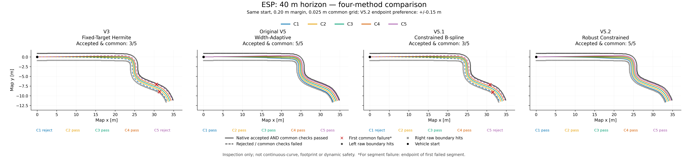

# Personal Research Journal：四版本候選路徑比較

## 來源與用途

- Repository：https://github.com/tim8026796-coder/f1tenth_benchmarks
- 演算法來源分支：`robust-adaptive-paths-v5.2`
- 演算法來源 commit：`1040465f0171ed41b452731fc2685b2b0cc2dd26`
- 圖片分支：`research-journal-v52-figures`；日期：2026-10-16（Asia/Taipei）。
- 使用前次共同驗證的原始 JSON 座標與 CSV；本次沒有呼叫路徑生成器、最佳化器或重跑驗證，沒有手工繪製、平滑、移動或重新接受任何候選。
- 未修改主程式、測試、master、組員 repository 或 PR #5。

## 圖片

|檔案|內容|尺寸與解析度|
|---|---|---|
|[esp_40_four_methods.png](esp_40_four_methods.png)|ESP 起點 (0,0)，前視 40 m，完整候選區域|6000 × 1400 px，250 dpi|
|[esp_40_zoom.png](esp_40_zoom.png)|同一份 ESP 資料的彎道局部放大|6000 × 2000 px，250 dpi|
|[narrow_1m_four_methods.png](narrow_1m_four_methods.png)|突變窄道 1.0 m，起點 (1.5,3)，前視 4 m|6000 × 2000 px，250 dpi|

四欄由左至右固定為 V3 – Fixed-Target Hermite、Original V5 – Width-Adaptive、V5.1 – Constrained B-spline、V5.2 – Robust Constrained。每張圖的四欄使用相同範圍、equal aspect；放大圖改變視窗，不改變資料。

## 共同條件與通過數

- 道路邊距 0.20 m；共同參考 s 檢查間距 0.025 m；V5.2 明確使用 ±0.15 m 終點偏好。
- 接受定義：原生接受 AND 共同幾何／邊距／occupancy 線段檢查通過。原生拒絕的診斷曲線不能重新升格。
- 下表數據已逐項比對保存的 JSON 與 summary.csv，與既有 report.md 一致。

|案例|方法|原生接受|共同通過|交集／5|
|---|---|---:|---:|---:|
|esp_40|V3|3|3|3/5|
|esp_40|Original V5|5|5|5/5|
|esp_40|V5.1|3|3|3/5|
|esp_40|V5.2|5|5|5/5|
|narrow_1.0|V3|1|1|1/5|
|narrow_1.0|Original V5|5|1|1/5|
|narrow_1.0|V5.1|5|5|5/5|
|narrow_1.0|V5.2|5|5|5/5|

## 圖例與失敗標記

- C1 藍、C2 橙、C3 綠、C4 朱紅、C5 紫；三張圖及所有子圖保持一致。
- 實線：交集接受。虛線：原生拒絕或共同檢查失敗。各面板下方另列每個 ID 的 pass／reject。
- 紅色 ×：JSON 的 first_invalid_sample。對 occupancy 線段失敗，這是第一個失敗線段的後端採樣點，不代表該端點本身就是碰撞格位置。
- 灰色圓／方散點：從相同 geometry_id、來源影像與 YAML 重新呼叫原始 boundaries() 取得的左右射線命中點。查詢使用保存的共同 s 網格，顯示約每 0.15 m 一點並保留突變前後點；未使用平滑牆線或插值邊界。
- 淺灰點線是參考線，不是道路邊界；黑點為車輛起點，ESP zoom 的起點位於視窗外。
- ESP zoom 四欄均為 x=[26.3,36.3] m、y=[-13.4,-2.2] m，包含所有 ESP 首次共同失敗點；其餘前段刻意不顯示。完整圖不裁切候選資料。

## 原始資料與可追溯性

原始保存目錄：`/workspace/artifacts/v52/four-version-study-1040465/`。這是先前工作區實際結果，不是 GitHub 已公開資料網址；本圖片分支僅提交三張 PNG 與本 README。

|資料檔案|SHA-256|
|---|---|
|`esp_40.json`|`d448c8fed9acc2718f4958b4a4e4df36799f0f2b107f2c7da5a0af0a9335eedd`|
|`narrow_1.0.json`|`49a1f8d45cf8b5b91f1fbf4a2b5ce2f79381b7e3cc666c762583da87bd017978`|
|`comparison.json`|`50d9cfc3f6fe1dbf5f5bd41233a190cd2cff1fbdfbbc3779edf944d3a0b6ddd6`|
|`summary.csv`|`dcc31ef6dc813539bcc8f921bef25b54c62927bdad24f54942611efd8b822714`|
|`candidates.csv`|`4804f819b3680745fddc998023eb222c2bf074d739d939d56aeefdada25b034b`|
|`report.md`|`c9c82e58a18ac7a339aaa88326d52427ffe302c0c460e91b37fd866fb026306e`|

ESP 來源影像／YAML 及 Frenet 幾何：`maps/esp.png`、`maps/esp.yaml`、`maps/frenet/esp/geometry/`，均來自演算法來源 commit；載入時核對 geometry_id 及來源 hash。人工窄道由既有比較工具的 make_narrowing_geometry(1.0) 重建相同 raster（只用於邊界繪圖），已核對保存的 geometry_id。沒有重新產生候選。

## 本次檢查結果與限制

- 已完成：JSON／CSV 計數一致、三張 PNG 解碼及 ≥200 dpi 查核、完整候選範圍與 zoom 失敗點範圍檢查、人工查看圖例／字體／四欄比例。
- 本次沒有修改演算法或測試，因此未重跑最佳化或程式回歸；圖表成功不算新的安全驗證。
- inspection_only=true、planning_allowed=false。共同檢查不替 V3／原始 V5 添加它們原本沒有的曲率或斜率限制。
- 未驗證連續樣條、車身掃掠、速度／動態、對手預測或實際車輛安全；V5.2 尚未接入 Pure Pursuit。

