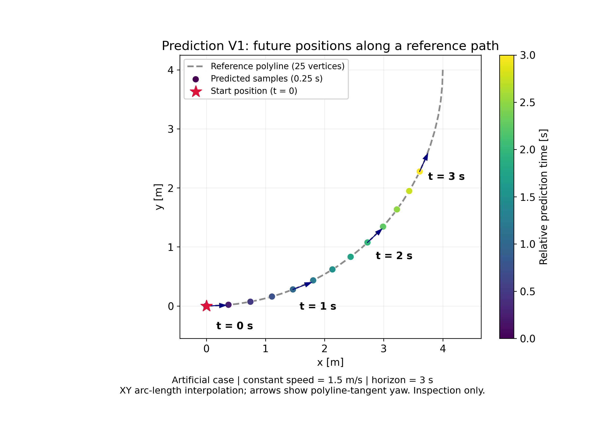
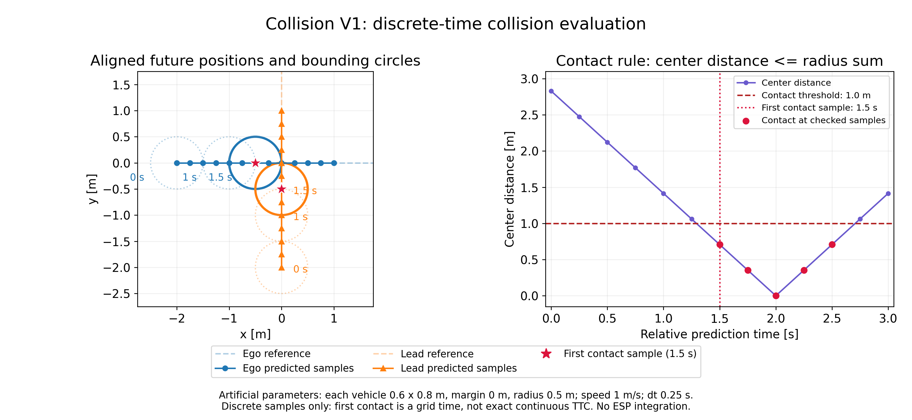

# Personal Research Journal — 2026-10-23

## Prediction V1 / Collision V1：預測碰撞評估的初步研究成果

本目錄提供教授及助教閱讀的研究圖片與精簡表格。圖片使用既有 Python 模組的實際人工案例輸出，沒有人工指定預測點或接觸結果，也沒有修改研究演算法。

### 檔案

| 檔案 | 用途 |
|---|---|
| [prediction_v1_demo.png](prediction_v1_demo.png) | 單車沿彎曲折線的未來位置、0～3 s 時間標記、起點與 yaw 箭頭 |
| [collision_v1_demo.png](collision_v1_demo.png) | 雙車同步交叉、代表時刻外接圓、首次接觸樣本，以及中心距離時間序列 |
| [test_summary.md](test_summary.md) / [test_summary.csv](test_summary.csv) | Prediction 53、Collision 49、合計 102 passed |
| [module_summary.md](module_summary.md) / [module_summary.csv](module_summary.csv) | 主要函式、用途及限制 |
| [繪圖腳本](../../../tools/generate_prediction_collision_journal_assets.py) | 呼叫既有 V1 模組重現兩張圖，既有同名 PNG 不會被覆寫 |

兩張 PNG 均為白底、250 dpi、英文標題與單位。圖形只用於離線研究展示，不代表已完成 ESP 雙車模擬整合。

### 圖 1：單車時間預測



人工參考路徑由半徑 4 m 的四分之一圓弧取 25 個點，作為 **XY 折線**，不是以解析圓弧公式替代模組內插。

- `angle = linspace(0, pi/2, 25)`，`x = 4*sin(angle)`，`y = 4*(1-cos(angle))`。
- 起點 `(0,0)`，速度 `1.5 m/s`，`dt=0.25 s`，`H=12`，共 13 個時間點，包含 `t=0`。
- 使用 `predict_polyline()` 的累積弧長與線性內插結果；完整度為 `complete`。
- 點色表示相對預測時間，標註 `t=0,1,2,3 s`，箭頭表示模組計算的折線切線 yaw。
- 參考折線全長顯示至 90 度；預測只沿其前段前進 4.5 m。

### 圖 2：未來時間序列接觸檢查



人工雙車案例：ego 沿 `(-2,0) → (4,0)`，lead 沿 `(0,-2) → (0,4)`；兩車速度均為 `1 m/s`，`dt=0.25 s`，`H=12`，共同預測起點為 `0 s`，`frame_id=synthetic_map`。

所有尺寸都是人工測試參數，並非實車或學長車輛設定：

- 各車 `length=0.6 m`、`width=0.8 m`、`margin=0 m`。
- 各車外接圓半徑 `hypot(0.6,0.8)/2=0.5 m`，接觸門檻為中心距離 `<=1.0 m`，包含相切。
- 代表時刻 `0,1,1.5 s` 畫出兩車安全圓；實線圓及紅星對應首次接觸網格樣本。
- t=0 不接觸；首次接觸樣本為 **1.5 s**，當時中心距離約 **0.707107 m**。
- 最小中心距離為 **0 m，發生於 2 s**；完整評估 0～3 s。
- 右圖直接顯示各時間樣本的中心距離與門檻，證明檢查不是只比較當前位置。

本案例連續接觸開始時間不等於 1.5 s；本版沒有計算精確連續 TTC，也沒有檢查樣本間掃掠。`no_contact_at_samples` 不代表實際可安全行駛。

### 測試數據來源與已知問題

採用先前 2026-10-23 已實際重新執行的專屬測試紀錄：

```text
Prediction V1: 53 passed
Collision V1: 49 passed
Total: 102 passed in 10.99s
Python: 3.9.25
```

原始驗證程式位於當時 Codex 環境：

- `/workspace/artifacts/prediction-v1/verify_prediction_v1.py`
- `/workspace/artifacts/collision-v1/verify_collision_v1.py`
- 合併紀錄：`/workspace/artifacts/prediction-collision-audit-20261023/tests.log`

這些測試尚未提交 repository；此圖片分支不宣稱提供完整 CI。102 項包含解析解、投影歧義、零速、重複點、路徑不足、相切、交叉不同時、時間／frame 不一致、人工 candidate 串接與 CLI 等；不是全專案回歸或真實 ESP 評估。

**已知尚未修正問題：** 0.3 m 路徑、0.1 m/s、dt=0.1 s、H=30 時，prediction 可輸出 `complete`，但 `available_until_t_s=2.9999999999999996`，最後樣本時間為 3.0；collision 因嚴格範圍檢查而回報 `rejected / inconsistent_available_range`。這是額外探查發現的誤拒絕，未被上述 102 項涵蓋。本次僅製作展示資料，不修補該問題，也不將 102 passed 宣稱為所有邊界情況均正確。

### 程式來源與重現

Repository：`tim8026796-coder/f1tenth_benchmarks`。

- 圖片分支：`journal-prediction-collision-assets`。
- 工作來源：本機 `work`，基底 HEAD `97e121b28d4bc1f29c65c9a1d4ca4b142d8049a8`。
- 兩個 V1 模組是當時本機未追蹤檔案，**不屬於基底 HEAD，也沒有隨本圖片提交加入**。
- 實際使用的檔案 SHA256：

```text
prediction_v1.py
ad7b49a8ec097a2a6fe969b016e7830caed32a71073b5aa3bc4630a793b5bb54
collision_v1.py
64b1c573ced53831c6bb76c7d542c4acd6928134677b3cb11e989316bc2226de
```

繪圖腳本需要本機具有這兩個 V1 模組及現有 numpy／matplotlib 依賴；單獨 checkout 本圖片分支尚不足以重現。請勿將基底 commit 當成已包含兩個 V1 模組的版本。

從專案根目錄執行，使用新輸出目錄：

```bash
PYTHONPATH=. python tools/generate_prediction_collision_journal_assets.py --output-dir journal-preview-new
```

Windows PowerShell：

```powershell
$env:PYTHONPATH = (Get-Location).Path
python tools/generate_prediction_collision_journal_assets.py --output-dir ".\journal-preview-$(Get-Date -Format 'yyyyMMdd-HHmmss-fff')"
```

Linux 指令已實際執行；PowerShell 指令未在 Windows 驗證。

### 研究範圍

本次只增加圖片、表格、說明及獨立繪圖腳本，不修改 prediction、collision、V5.2、Geometry API、Pure Pursuit 或 Simulator；不建立 PR、不合併。

所有結果維持 `inspection_only=true`、`planning_allowed=false`。尚無加速度預測、矩形車身精確碰撞、連續掃掠、預測不確定性、路徑選擇或車輛控制批准。
