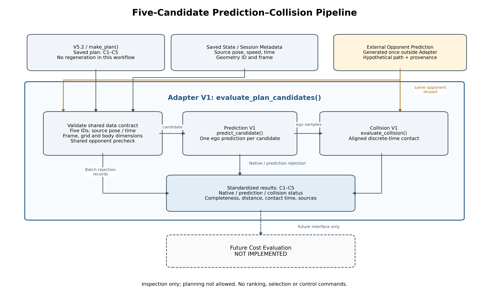
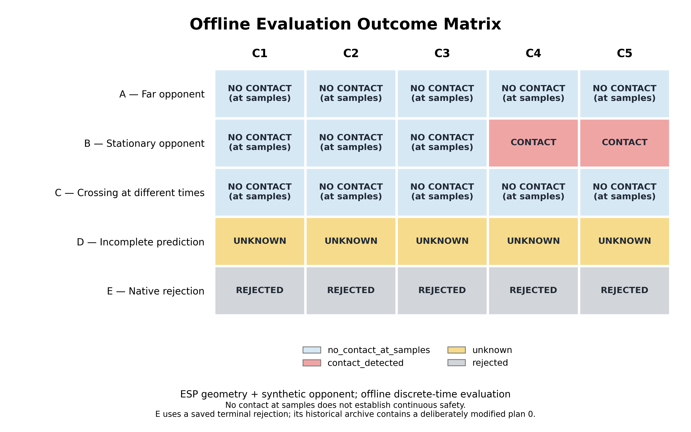

# Personal Research Journal — 2026/11/06

本次為 2026/11/06 週報製作兩張新圖並沿用一張既有圖。依使用者指定，分支及保存目錄保留 `20261105`／`journal_2026_11_05` 命名，不代表成果日期改成 11/05。

## 來源與範圍

- Repository：tim8026796-coder/f1tenth_benchmarks。
- 圖片分支：journal-20261105-assets。
- 圖片基底：84a8c7503c81ce58026e848557b3059c38e0185f。
- 研究分支 prediction-collision-integration-v1 及 fork/master 未修改；沒有 PR、合併或 force push。
- 只增加兩張 PNG、本 README 與獨立繪圖腳本。不修改模型、規劃器或成本函數，不重新執行最佳化或新增研究測試數據。

## 圖片與週報建議位置

| 圖片 | 內容與資料來源 | 建議週報章節 |
|---|---|---|
| [01_prediction_collision_pipeline.png](01_prediction_collision_pipeline.png) | 依提交程式的真實呼叫關係製作的架構圖；Adapter 包住契約檢查、Prediction、Collision 與標準化結果 | Method / System Architecture |
| [02_offline_outcome_matrix.png](02_offline_outcome_matrix.png) | 依 25 筆 CSV 與 A～E JSON 核對後產生，四種狀態分色、逐格標字 | Results / Offline Evaluation |
| [沿用 esp_offline_B.png](../esp_collision_offline_v1/esp_offline_B.png) | 原圖保持逐位元一致，未重新繪製、未複製；同步 t=4.5 s 的 C4/C5 接觸展示 | Case Study / Discussion |





## 圖 1 的呼叫關係

已閱讀 session.make_plan、robust_adaptive_paths、Prediction V1、Collision V1、Adapter V1 及 evaluate_esp_collision_v1.py。

- V5.2／make_plan 的五候選在本工作流程已保存，不重新生成。
- source pose/time 與 state 速度、session frame／geometry 是 Adapter 契約輸入；不能用 available_sim_time_s 或 points.t 代替來源時間。
- 對手預測在 Adapter 外產生一次，帶人工假設與 provenance，經預查後由五候選共用。
- Adapter 先驗證共用資料，逐候選呼叫 predict_candidate，再對可用預測呼叫 evaluate_collision。原生拒絕在 Prediction 階段保留；批次契約拒絕直接保存結果。
- 共用對手預查實際使用 Collision 自配對作契約驗證，圖中以 Shared opponent precheck 表示，不把該診斷當成實際車輛接觸結果。
- 標準輸出包含五個 ID、原生狀態、完整度、距離、接觸時間、未知範圍與來源。
- Future Cost Evaluation 在 Adapter 外使用虛線框與箭頭，明確標 NOT IMPLEMENTED。圖不代表已實作成本、排序或控制。

## 圖 2 的實際資料與核對

固定來源 commit：84a8c7503c81ce58026e848557b3059c38e0185f。

- [原始 CSV](https://github.com/tim8026796-coder/f1tenth_benchmarks/blob/84a8c7503c81ce58026e848557b3059c38e0185f/docs/research/esp_collision_offline_v1/all_cases.csv)
- [研究 README](https://github.com/tim8026796-coder/f1tenth_benchmarks/blob/84a8c7503c81ce58026e848557b3059c38e0185f/docs/research/esp_collision_offline_v1/README.md)
- 同目錄 results/A～E/summary.json 與 scenarios/A～E.json，均實際讀取並核對。

繪圖腳本逐欄比對 CSV 的全部 25 筆紀錄與結果 JSON，核對情境 JSON 完全一致、候選 ID 為 1～5 且無重複。若不同立即拋錯，不補值、不改數據。

| 案例 | C1 | C2 | C3 | C4 | C5 |
|---|---|---|---|---|---|
| A — Far opponent | no_contact_at_samples | no_contact_at_samples | no_contact_at_samples | no_contact_at_samples | no_contact_at_samples |
| B — Stationary opponent | no_contact_at_samples | no_contact_at_samples | no_contact_at_samples | contact_detected | contact_detected |
| C — Crossing at different times | no_contact_at_samples | no_contact_at_samples | no_contact_at_samples | no_contact_at_samples | no_contact_at_samples |
| D — Incomplete prediction | unknown | unknown | unknown | unknown | unknown |
| E — Native rejection | rejected | rejected | rejected | rejected | rejected |

本次沒有資料不一致或缺件。另以暫存副本故意更改一筆 CSV outcome，確認程式拒絕且不產生圖片；沒有修改研究資料。

## 格式與重現

兩張新圖均為白底、英文標題與標籤、250 dpi；流程圖 3750×2250，矩陣 3000×1875。已用 Pillow 解碼查核，並人工檢查圖例、字體與布局。既有 B 圖維持原 220 dpi。

[繪圖腳本](../../../tools/generate_journal_20261106_figures.py) 不匯入或呼叫生成器／最佳化器，也不重跑研究測試。

從專案根目錄，在具備既有 numpy、matplotlib 依賴的 Python 環境執行：

```bash
python -m tools.generate_journal_20261106_figures --output-dir journal-1106-preview-new
```

Windows PowerShell：

```powershell
python -m tools.generate_journal_20261106_figures --output-dir "journal-1106-$(Get-Date -Format 'yyyyMMdd-HHmmss-fff')"
```

若同名圖片已存在會拒絕覆寫。Linux 已實際執行；Windows 未實測。

## 研究限制與圖說

圖說：**ESP geometry + synthetic opponent; offline discrete-time evaluation**。

來源是官方 ESP 流程留下的 3 m 單車短預覽，加上人工對手，不是真實雙車模擬。B 的 C4/C5 是離散網格接觸；D 的未知區間不可判為無接觸。E 使用歷史 terminal plan，其 archive 的 plan 0 被先前測試故意修改，不能當成完整正常 session。

no_contact_at_samples 不等於連續時間安全；沒有車身掃掠或動態安全驗證。維持 inspection_only=true、planning_allowed=false。
