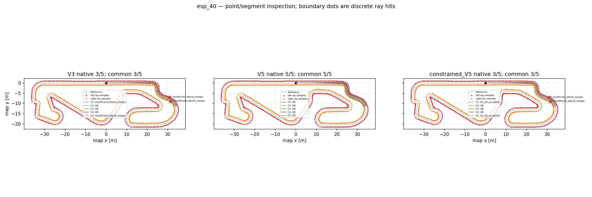
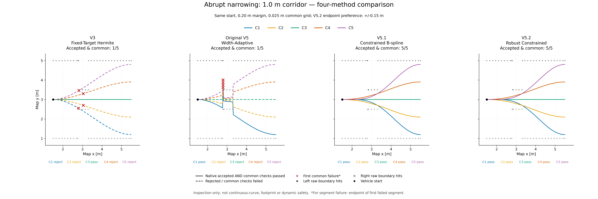
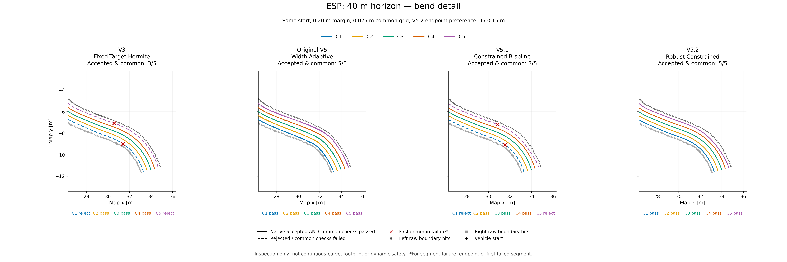

# F1TENTH 期中報告圖片素材：Frenet 五候選至可變路寬 V5.2

整理日期：2026-10-28（Asia/Taipei）。本次只搜尋、核對、複製既有成果，沒有重跑候選生成、最佳化、共同驗證或程式測試，也沒有製作 PPT。

## 分支與修改範圍

- Repository：`tim8026796-coder/f1tenth_benchmarks`。
- 圖片分支：`midterm-v52-figures`。
- 建立基底：遠端 `robust-adaptive-paths-v5.2`，核對到 commit `023f654b970270f67ecfdab91f18cff51a522263`。
- 本提交僅增加本目錄的三張 PNG 與 README，不修改 V5.2、Geometry API、Pure Pursuit、Simulator 或測試；不建立 PR、不合併。
- 四版本圖片的原始演算法來源是當時 commit `1040465f0171ed41b452731fc2685b2b0cc2dd26`（依原圖片 README 記錄），不可與本次分支基底混為同一版本。

## 圖片與建議簡報頁次

未提供期中簡報檔，因此下列頁碼只是編排建議，不是已確認的正式頁碼。

| Figure／建議頁次 | 檔案 | 實際內容與狀態 | 本次重新生成 |
|---|---|---|---|
| Figure 1／P3：原始方法 | `01_original_frenet_lattice.png` | **缺件，未建立**。未找到 `20260429_GroupMeeting.pdf`，無法擷取第 9 頁 | 否 |
| Figure 2／P4：ESP 候選驗證 | [02_esp_candidate_validation.png](02_esp_candidate_validation.png) | 既有 `esp_40.png`，三欄為 V3／Original V5／V5.1；包含 V3 五候選，不是單獨的 V4 圖 | 否；只複製改檔名 |
| Figure 3／P5：突變窄道比較 | [03_narrow_1m_four_methods.png](03_narrow_1m_four_methods.png) | 四欄 V3／Original V5／V5.1／V5.2，1.0 m 窄道 | 否；只複製改檔名 |
| Figure 4／備用 P6：ESP 彎道放大 | [04_esp_40_four_methods_zoom.png](04_esp_40_four_methods_zoom.png) | 真正四版本 ESP 40 m 同比例局部放大 | 否；只複製改檔名 |

### Figure 1：缺少學長原始來源

已搜尋 `/workspace`、`/tmp` 的 PDF 與相關檔名，並檢查本次取得的 V5.2／既有圖片分支檔案清單；未找到 `20260429_GroupMeeting.pdf`。

沒有從網路抓取不確定版本、沒有重畫原圖、沒有用本專案圖片冒充學長成果。請提供該 PDF，之後才能擷取第 9 頁圖示區域並保持比例。正式引用應標示「來源：20260429_GroupMeeting.pdf，第 9 頁」，作者／出處待原文件確認；不能標成自行產生的成果。

### Figure 2：ESP 40 m，既有三版本全圖

- 原始圖片：[research-comparison-results / esp_40.png](https://github.com/tim8026796-coder/f1tenth_benchmarks/blob/d2b2b2d4f564391fbcc73056df6bf195cd690c3f/research_results/comparison/esp_40.png)。
- 圖片來源 commit：`d2b2b2d4f564391fbcc73056df6bf195cd690c3f`；原比較演算法 commit：`97e121b28d4bc1f29c65c9a1d4ca4b142d8049a8`。
- 原始條件及候選原因：[report.md](https://github.com/tim8026796-coder/f1tenth_benchmarks/blob/d2b2b2d4f564391fbcc73056df6bf195cd690c3f/research_results/comparison/report.md)；數值：[summary.csv](https://github.com/tim8026796-coder/f1tenth_benchmarks/blob/d2b2b2d4f564391fbcc73056df6bf195cd690c3f/research_results/comparison/summary.csv)。
- ESP 起點 `(0,0)`，前視 40 m，側向邊距 0.20 m，共同參考 s 間距 0.025 m。
- 原記錄起始 Frenet s：236.83063142271715 m；geometry_id：`c53238c43d356997b7035bacb1907958cbc35d77d8f8916ec4691ca9c934de71`。
- 三欄原生接受／共同通過皆為 `3/5、5/5、3/5`。V3 的 C1、C5 為 `insufficient_lateral_margin`，C2～C4 通過；V5.1 的 C1、C5 原生為 `fit_not_accepted`，共同診斷曲線仍不通過邊距。
- 包含左右離散邊界射線命中點、C1～C5、拒絕虛線與首次失敗標記。這是三版本歷史成果，不含 V5.2，不冒充四版本或純 V4 圖。
- 尺寸 2700×900、約 150 dpi。全賽道與內嵌圖例使局部候選偏小；本次不重新繪製或裁切。若需教授清楚閱讀彎道細節，優先用 Figure 4。

### Figure 3：突變窄道 1.0 m，四版本比較

- 原始圖片：[research-journal-v52-figures / narrow_1m_four_methods.png](https://github.com/tim8026796-coder/f1tenth_benchmarks/blob/688a9fd91dde85880223efcd67fd16326c1f686a/docs/research/figures/2026-10-16/narrow_1m_four_methods.png)。
- 起點 `(1.5,3)`，前視 4 m，窄道寬 1.0 m，側向邊距 0.20 m，共同參考 s 間距 0.025 m；V5.2 終點偏好設定為 ±0.15 m。
- 四欄順序：V3 – Fixed-Target Hermite／Original V5 – Width-Adaptive／V5.1 – Constrained B-spline／V5.2 – Robust Constrained。
- 圖中交集通過數依序 `1/5、1/5、5/5、5/5`。V3 僅 C3 通過；Original V5 僅 C1 通過；V5.1、V5.2 全五條通過。
- Original V5 **原生接受為 5/5，但共同通過為 1/5**，不可把它的原生 5/5 說成共同驗證也 5/5。圖上可見其橫向跳變；V5.1／V5.2 曲線較平滑。
- 尺寸 6000×2000、約 250 dpi，四欄使用同範圍與等比例座標。

### Figure 4：ESP 40 m，四版本彎道局部放大

- 原始圖片：[research-journal-v52-figures / esp_40_zoom.png](https://github.com/tim8026796-coder/f1tenth_benchmarks/blob/688a9fd91dde85880223efcd67fd16326c1f686a/docs/research/figures/2026-10-16/esp_40_zoom.png)。
- ESP 起點 `(0,0)`，前視 40 m，側向邊距 0.20 m，共同參考 s 間距 0.025 m；V5.2 終點偏好 ±0.15 m。
- 四版本順序同 Figure 3，交集通過數為 `3/5、5/5、3/5、5/5`。
- V3／V5.1：C1、C5 拒絕；C2～C4 通過。Original V5／V5.2：C1～C5 皆通過此交集檢查。
- 四欄皆 x=[26.3,36.3] m、y=[-13.4,-2.2] m，equal aspect。起點不在此視窗內；它仍然是從 `(0,0)` 開始的 40 m 結果，不是另選局部起點重算。
- 尺寸 6000×2000、約 250 dpi。

## 通過數核對與線型語義

| 案例 | V3 | Original V5 | V5.1 | V5.2 |
|---|---:|---:|---:|---:|
| ESP 40 m | 3/5 | 5/5 | 3/5 | 5/5 |
| Narrow 1.0 m | 1/5 | 1/5 | 5/5 | 5/5 |

這裡的通過數是 **原生接受 AND 共同檢查通過**，不是只看原生接受數，也不是將診斷曲線重新接受。

四版本圖例已人工檢視，與原圖片說明一致：

- 實線：原生接受且共同檢查通過。
- 虛線：原生拒絕或共同檢查失敗；不能當成可執行路徑。
- 紅色 ×：首次共同失敗的採樣標記。若原因是 occupancy 線段失敗，標的是第一個失敗線段的後端採樣點，不是精確碰撞座標。
- C1～C5 在四版本圖中使用一致顏色。Figure 2 為另一批歷史繪圖配色，不將不同圖的顏色直接當成方法識別。
- 灰色圓／方散點是左右道路邊界的原始離散射線命中結果，不是已驗證的連續牆線；參考線也不是道路邊界。

Original V5 在 ESP 通過 5/5 不表示已符合 V5.1／V5.2 的平滑限制；共同驗證不能替舊方法追加其原本未具備的演算法約束。

## 來源完整性與本次核對界線

四版本圖片與條件的來源說明：[原 README](https://github.com/tim8026796-coder/f1tenth_benchmarks/blob/688a9fd91dde85880223efcd67fd16326c1f686a/docs/research/figures/2026-10-16/README.md)。本次已核對圖上的方法、ID、通過數、線型及上述條件，並將三版本 ESP 的條件與數值另比對其保存的 report／summary.csv。

**四版本原始 JSON／CSV 目前不在本工作環境，也未包含於原圖片分支。** 原 README 記錄的歷史目錄 `/workspace/artifacts/v52/four-version-study-1040465/` 本次搜尋未找到。因此本次能確認圖片與既有說明一致，不能宣稱重新逐點核對四版本 JSON／CSV、重新計算通過數或完成新的幾何驗證。原 README 保存的資料 hash 仍可用於日後找回來源後核對。

本次 PNG 直接從來源 commit 的 Git blob 複製，只有檔名改變；以 Git blob ID 與 SHA256 核對，沒有裁切、重採樣、重新繪圖或更改圖上數字。三張 PNG 均已通過 Pillow 解碼驗證及人工查看。

| 本次檔案 | SHA256 |
|---|---|
| `02_esp_candidate_validation.png` | `69bfb57155f959b982aaba5a49b5bbcc93c1af53d0687bda5b8159eb8be24c8c` |
| `03_narrow_1m_four_methods.png` | `1a477f234d31f8d7761bcff27c55bf4a3f7abf1e4ef84712189483ab21785f63` |
| `04_esp_40_four_methods_zoom.png` | `2b09aeca36d5743302f70afb6fbb68f4b52180ab5497bac21f124dae1c06e018` |

## 尚缺素材與安全限制

1. `20260429_GroupMeeting.pdf` 第 9 頁原圖：需要提供 PDF；未建立 Figure 1 佔位 PNG。
2. 四版本原始 JSON／CSV：若要追溯逐點座標與重新驗算，需要找回歷史成果；本次依要求不重跑最佳化。
3. 正式期中報告頁碼：未提供簡報，目前只有建議 P3／P4／P5／備用 P6。

本次未執行新的安全驗證。所有結果仍屬 `inspection_only=true`、`planning_allowed=false`；不代表連續樣條、車身掃掠、速度／動態或實車安全已驗證。
